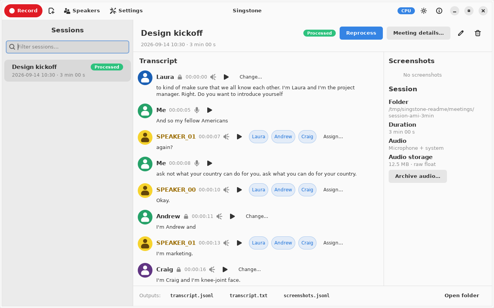
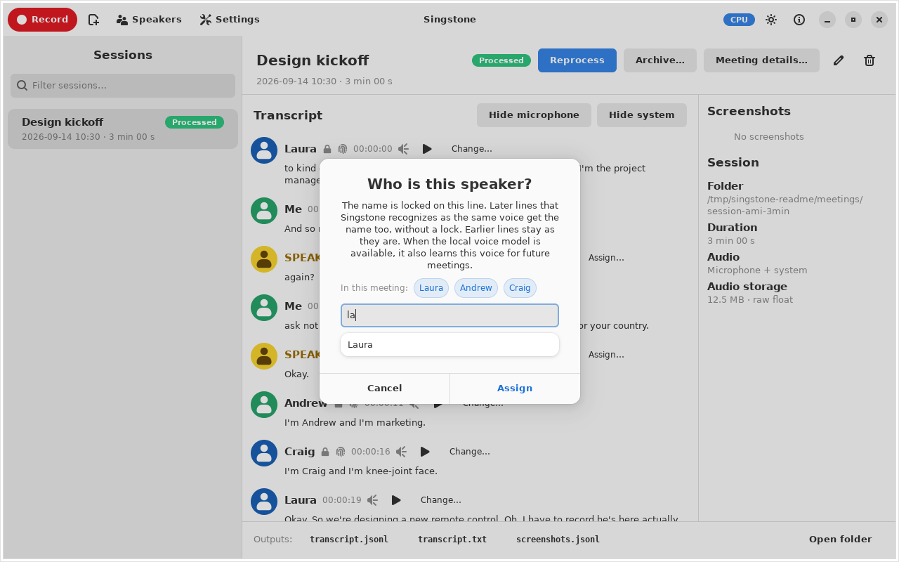
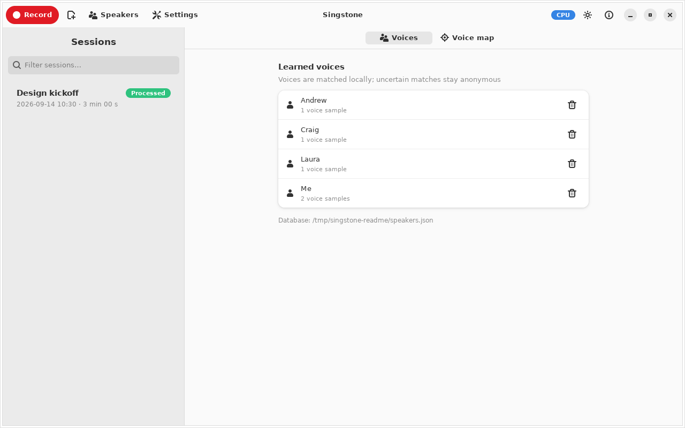
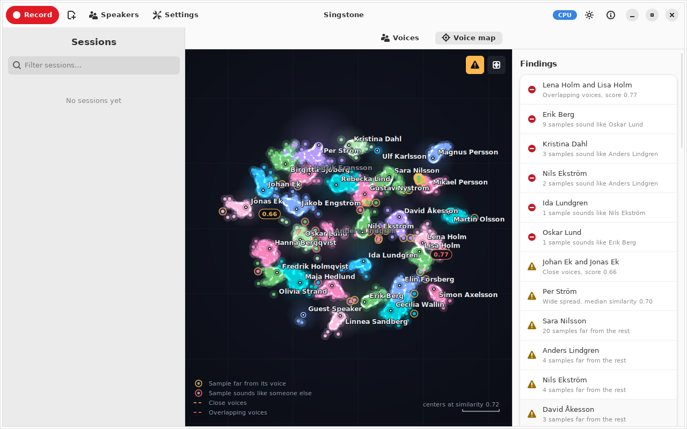
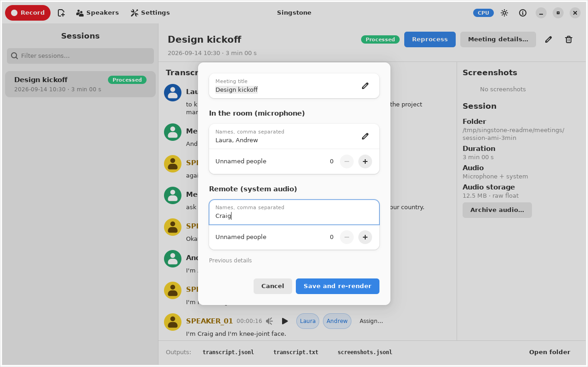
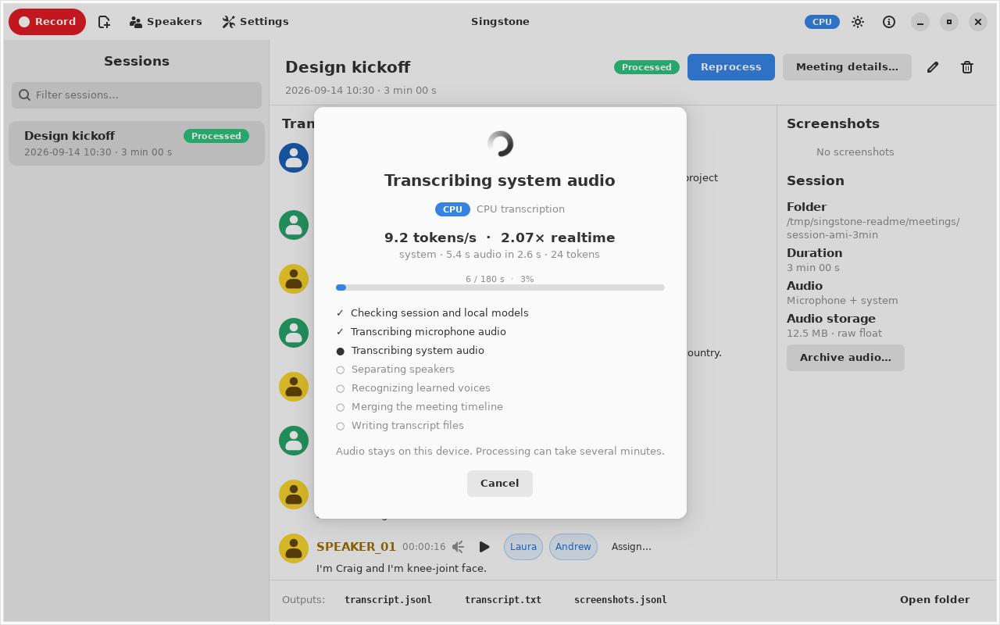

<div align="center">
  <h1>singstone</h1>
  <p>Local meeting recording, transcription, and speaker diarization for Linux and PipeWire.</p>

[](https://nsg.github.io/aibadge/#vibe)
</div>

## About

Singstone records microphone and system audio on one clock, optionally collects
screenshots, and produces a timestamped, speaker-attributed transcript. Recording
and machine-learning inference run locally.

The supported distribution is a strictly confined core24 Snap for AMD64 Linux.
It contains the application and source-built native runtimes. Model
weights download on first use and remain in a persistent per-user cache.

## Application

Once recording stops, a session opens with a player: both tracks drawn as
waveforms on one time axis, with the screenshots marked where they were taken.
Click or drag to scrub, hover to read the time, press Space to play or pause
and ←/→ to jump 5 seconds; the clock also shows the wall-clock time at the
playhead. The **Microphone** and **System** buttons mute a track while
listening. A recording that has not been processed yet can be cut in two, see
[Split a recording](#split-a-recording).

Browse processed meetings and review speaker-attributed transcripts from the
session view, below the player. Microphone lines sit to the left of a shared
timeline and system audio lines to the right; speech that overlaps shares a
row. Loudspeaker sound picked up by the microphone stays visible, dimmed and
marked **Echo**, beside the remote line it repeats. Confirm individual names so
they stay locked across reprocessing, use quick speaker shortcuts on anonymous
lines, or change a named line.
Use **Hide microphone** or **Hide system** to leave that source out of
both transcript files without deleting anything. Hiding the microphone is
useful when you mostly listened and it recorded leaked speaker audio: lines
recognized as your voice, or named by you as **Your name in the transcript**,
stay in, echo excepted.
Show the hidden lines to right-click one and keep just that line or every line
of its speaker. What is kept is listed next to the toggles, where ✕ stops
keeping a speaker, yourself included.
When a recording starts before the meeting or runs on after it, right-click a
line or its time and choose **Meeting starts here** or **Meeting ends here**.
Lines outside the meeting fold away and are left out of both transcript files;
**Show** brings them back greyed, so a mark can be moved by marking another
line. No voice is learned from a line outside the meeting. The ✕ on a mark, or
**Use the whole recording** in the Session panel, puts it back. The audio is
kept and nothing needs reprocessing.



Type a speaker name to filter learned voices and names already used in the
meeting, then choose a suggestion or assign a new name.



Naming a line locks that line and also names the later lines that Singstone
recognizes as the same voice. Those later lines stay unlocked, so a later
choice can rename them. Earlier lines are never changed. A lock icon marks a
line you named, and a fingerprint icon marks a line whose voice was learned.

Open Speakers to inspect the locally learned voices and the number of voice
samples stored for each person.



Switch to **Voice map** to see every learned voice sample as a dot, one color
per person. People whose voices sound alike sit close together, and their
clouds overlap when the recognizer can barely tell them apart. A dashed line
joins voices that are close or overlapping, labeled with the score one
person's samples get against the other's. Rings mark single samples that sound
more like someone else, often a line named after the wrong person, or that lie
far from the rest of their voice, such as a noisy recording. Findings on the
right list these problems; choose one, or a person under Voices, to zoom in on
it. Hover a dot to see whose sample it is and how it scores. The map is a flat
approximation of the distances between voices: the scale bar shows how far
apart two centers sit when their voices are exactly at the match threshold,
and the scores are exact where the picture is not.

Learned voices are tidied automatically. When you name a line, chunks in it
that clearly sound like another known person, such as a colleague's quick
"sounds good" inside your line, are not learned. At start and after each
learning, a tidy pass deletes samples that sound like someone else or sit
isolated from the rest of their voice. A sample is judged only once its voice
has been learned in three later meetings, so a new microphone or room gets
time to build up, and a group of close samples heard in two or more meetings
stays however far it lies from the rest. Voices with fewer than 20 samples are
left alone, and one pass deletes at most a tenth of a voice. Samples are
compared with the voice's samples from other meetings, so a batch named after
the wrong person in one meeting goes as a whole. The map marks a sample due
for deletion with a crossed ring and one still settling with a dashed ring,
and the Speakers page says when a pass deleted something. To delete a sample
yourself, right-click it on the map and choose **Delete sample**. Deleted
samples no longer count for recognition but are kept for 30 days: **Show
deleted** (the trash button on the map) draws them faded, and right-clicking
one offers **Restore**, after which tidying leaves it alone.



Use Meeting details… to title the meeting and place attendees in the room or on
the remote end before re-rendering the transcript.



Processing runs in the background, one recording at a time. Press **Process**
on a recording and it starts at once; press it on the next ones and they wait
in a queue at the bottom of the session list. The rest of the application
stays usable, so a backlog can be queued up and left to finish. Select the
session in progress to follow each stage, and cancel it or remove a waiting
one at any time; cancelling takes effect at once. A failed session does not
stop the queue. Processing pauses the moment a recording starts, so it does
not compete with a call for the processor, and continues where it stopped
when the recording ends. Automatic suspend is held off until the queue is
empty.
Reprocessing replaces derived outputs and automatic speaker matches while
preserving the recorded audio and confirmed names.



When a processed session's speakers are checked, press **Mark done** to label
it **Done** in the session list. The label only marks the session as finished
for your own overview: **Unmark done** reverts it, reprocessing clears it, and
a session can be archived with or without it.

## Features

- Records a microphone, a PipeWire sink monitor, or both as aligned 16 kHz audio.
- Files screenshots against the same meeting clock.
- Transcribes with Whisper and separates speakers with pyannote and TitaNet.
- Automatically accelerates Whisper with Intel SYCL on a compatible Intel GPU,
  preferring Level Zero and retrying through OpenCL before using CPU.
- Recognizes learned voices while leaving uncertain matches anonymous.
- Uses per-meeting attendee details to guide speaker counts and recognition.
- Marks loudspeaker sound picked up by the microphone as echo by comparing the
  two recordings, without deleting it.
- Hides either audio source from a session's transcript without deleting it,
  keeping your own lines or any lines you pick.
- Marks where the meeting starts and ends in a longer recording, leaving the
  lines outside it out of the transcript and out of voice learning.
- Dictates short text from the microphone, such as a message or a prompt,
  without storing audio or text.
- Queues recordings for background processing, one after another, and pauses
  it for as long as a recording is in progress.
- Provides a native GTK interface with live capture meters, screenshot counts,
  per-stage processing progress, transcript-side audio playback, editable
  storage folders, and a one-click header Record button.
- Names speakers from the transcript: one-click shortcuts for people already
  in the meeting, and line-specific correction when a voice was matched to the
  wrong person. Confirmed lines remain locked across reprocessing.
- Plays a whole recording from a waveform timeline, with scrubbing and a
  mute per track.
- Splits a recording that has not been processed yet into two sessions at a
  chosen point, keeping the original as an archived backup.
- Renames sessions and deletes them, after a confirmation, from the session view.
- Flags a processed session as done, to tell reviewed sessions from those that
  still need attention.
- Archives a processed session's audio as 16-bit FLAC, about a fifth of the
  size, while keeping playback and reprocessing.
- Optionally deletes archived sessions after a chosen number of days.
- Optional GNOME Shell extension with a top-bar Record/Stop button and live
  level meters.
- Learns fixed-window voice embeddings when a transcript line is named or
  corrected, building a local speaker database from confirmed speech.
- Maps learned voices on a plane to reveal look-alike voices, mislabeled
  samples, and outliers in the speaker database.
- Keeps recording and inference offline under Snap confinement.
- Verifies every model's size, purpose, and SHA-256 before native code loads it.

## Quick start

Requirements:

- AMD64 Linux
- snapd 2.68 or newer
- PipeWire

The Snap is tuned for the Intel Iris Xe GPU in the Core i7-1185G7 and supports
the Intel GPU families covered by oneAPI 2026: 11th-generation Intel Core
integrated graphics and newer, Iris Xe, Arc, and Intel data-center GPUs. It
probes Level Zero at every launch, retries through Intel OpenCL if Level Zero
fails, and otherwise uses the existing CPU build. Older integrated GPUs can
pass a trivial SYCL kernel and still fail during Whisper inference, so the
launcher rejects them before selecting the GPU executable. Set
`SINGSTONE_DISABLE_GPU=1` to force the CPU path for diagnosis.
Swedish transcription uses KBLab's Swedish-tuned Whisper Small Q5_0 model and
sets the Whisper language to `sv` by default. A persistent, default-on Swedish
toggle in Settings switches to the multilingual OpenAI Whisper Small Q5_1
model with automatic language detection when turned off.
The probe writes its last completed stage and exit status to
`~/snap/singstone/common/gpu-probe.log`; when GPU startup fails, the CPU
indicator also shows the fallback reason.

Download the `.snap` directly from the rolling
[Latest release](https://github.com/nsg/singstone/releases/latest), then install
the unsigned build:

```bash
curl -fLO https://github.com/nsg/singstone/releases/latest/download/singstone_amd64.snap
sudo snap set system experimental.user-daemons=true
sudo snap install --dangerous ./singstone_amd64.snap
sudo snap connect singstone:opengl
sudo snap connect singstone:pipewire
```

The release is replaced after every successful `main` build; there are no
versioned releases. The package is not currently published in the Snap Store.
`--dangerous` tells snapd to accept the unsigned file; strict confinement still
applies. The snapd user-daemon feature is required for the per-user model setup
service.

Launch Singstone from the desktop application menu, or run it directly:

```bash
singstone
```

The GTK4 interface records meetings, browses existing sessions, displays
transcripts and timestamped screenshots, manages the local speaker list, and
runs the offline processing pipeline. The command-line interface remains
available for scripting and advanced processing.

### GNOME top bar control

The optional GNOME Shell extension adds a Record/Stop button and live audio
level meters to the top bar; Singstone must be installed and is launched
automatically when needed.
The panel polls the recorder status over D-Bus, so it does not depend on
session-bus signals reaching GNOME Shell.
The extension supports GNOME Shell 45 through 49.

Click the Record button to open its menu and start or stop a recording. An
update icon appears when a newer build is available; use **Update Singstone
and extension** to install both. It opens a terminal that downloads the snap
and the extension, closes Singstone if it is running (stop any recording
first), installs both after the `sudo` password prompt, and reopens Singstone.
Log out and back in to load the new extension. Update checks query the GitHub
API at most every six hours, plus when the menu is opened after 15 minutes.
Nothing is installed without clicking the update action.

Install the extension, then log out and back in (Wayland cannot load a new
extension into a running session):

```bash
curl -fLO https://github.com/nsg/singstone/releases/latest/download/singstone-gnome-shell-extension.zip
gnome-extensions install --force singstone-gnome-shell-extension.zip
# log out and in again
gnome-extensions enable singstone@nsg.github.io
```

### Record and process a meeting

List the available PipeWire sources and sinks:

```bash
singstone devices
```

Record microphone audio, system audio, and new screenshots. Stop with Ctrl-C:

```bash
singstone record --mic default --system default \
  --screenshots ~/Pictures/Screenshots \
  --local-speaker "Me" \
  --output-dir ~/Meetings
```

Process the created session directory:

```bash
singstone process ~/Meetings/session-20260914-103000
```

The first model-backed command downloads all four pinned models, about
393 MiB in total. Singstone displays percentage and byte progress, blocks until
the files pass verification, and then continues the command automatically:

```text
Downloading models [=                       ] 2% 9/393 MiB — kb-whisper-small-q5_0
```

Later commands reuse the cache. It survives Snap refreshes. The final outputs
are `transcript.jsonl` for programs and `transcript.txt` for people.

## Meeting details

When processing starts in the app, the **Meeting details** dialog asks for a
title and the known and unnamed people in the room and on the remote end. The
app stores the result as `meeting.json` inside that session. Use **Meeting
details…** on a processed session to revise it and re-render the transcript.
An empty title keeps the session's date-based default title. The pencil
button in the session header changes only the title, at any stage, without
re-rendering.

Set **Meeting context file** in Settings to prefill the dialog from a JSON
file created by calendar-export scripts or other local tools. A calendar knows
who was invited but not where anyone sat, so the file lists attendees only.
The dialog then asks, per attendee, whether that person was in the room,
remote, or did not attend, and lets you add people who were not invited.
Singstone reads its own interchange format only; it does not parse
calendar-provider formats or execute scripts. The file has this schema:

```json
{
  "format_version": 1,
  "meetings": [
    {
      "title": "Weekly planning",
      "start": "2026-09-25T10:00:00+02:00",
      "end": "2026-09-25T11:00:00+02:00",
      "attendees": ["Me", "Anna", "Bob", "Carol"]
    }
  ]
}
```

`format_version`, a non-empty `title`, and an RFC 3339 `start` with seconds
and either `Z` or a numeric offset are required. `end` and `attendees` are
optional. Names are trimmed and duplicate or empty names are ignored. Bad
files and bad entries are warned about and skipped without blocking
processing.

The session start must fall between 15 minutes before the meeting start and
the meeting end. Without `end`, the window ends 60 minutes after the start.
If several entries match, the closest start wins; ties use entry order. The
attendee matching the configured local speaker name starts as "In the room";
everyone else starts as "Remote". Existing session details take precedence
over the context file. The setting also accepts a folder of `*.json` files;
ties between files then use the file name.

The per-session file used by processing is:

```json
{
  "format_version": 1,
  "title": "Weekly planning",
  "local": { "known": ["Me", "Anna"], "unknown": 0 },
  "remote": { "known": ["Bob", "Carol"], "unknown": 2 }
}
```

Remote attendee count fixes system-audio clustering unless
`--num-speakers` was supplied. Known names narrow voice-recognition candidates
when that end has no unnamed attendees; microphone recognition uses only known
local names. Audio matching follows changes in loudspeaker delay and level
through the meeting, keeps picked-up words in both transcript formats, and
marks their lines as echo in `transcript.jsonl` and the app.

For command-line processing, `--meeting FILE` validates and copies a
`meeting.json`-shaped file into the session. The context file is not used on
the command line, since placing attendees needs a person to answer.

## Split a recording

When one recording holds two meetings, cut it in two before processing. Put
the playhead where the second meeting starts and press **Split here…**. An
orange cut line appears, with the two parts tinted and summarized below the
player: start time, length, and how many screenshots go with each. Drag the
line, nudge it by a second, or press **Snap to quiet** to move it into the
nearest stretch where both tracks are near silence; such stretches are faintly
hatched, and a warning says when the cut falls where someone is talking.
**Hear the cut** plays from 4 seconds before the line to 4 seconds after it.
Give each part a title, then **Split…** and confirm.

Splitting writes two new sessions and leaves the original alone until both
are complete. Both tracks are cut at the same sample; the second part starts
at the original start time plus the cut, and its folder is named after that
time. Screenshots, capture timing events, hidden sources and meeting marks go
with the part they belong to, shifted to its clock, and meeting details are
copied to both with the titles you chose. A new session's Session panel says
**Split from** the original and where. Only then is the original archived as
FLAC and kept in the session list as **Archived**, labelled **Split into** its
two parts, as a backup in case something is wrong with them. Splitting it
again, for example after deleting two parts cut at the wrong place, works the
same way. Old archives are deleted like any other once **Delete old archives**
is on.

Processed sessions also get the player, but **Split here…** is disabled: the
transcript and speaker work would not carry over. A session waiting in or
going through the processing queue cannot be split either.

The same works from a terminal; `--at` takes seconds, `M:SS` or `H:MM:SS`:

```bash
singstone split ~/Meetings/session-20260914-103000 --at 41:12 \
  --first-title "Weekly sync" --second-title "Design review"
```

Without titles, the parts are called after the original, the second with
" (2)" appended. Splitting checks for enough free disk space first and needs
the `flac` program to archive the original.

## Archive audio

Recordings are raw 32-bit float audio, about 230 MB per hour and track.
**Archive…** on a processed session, or `singstone archive SESSION`,
converts each track to 16-bit FLAC, typically a fifth of the size:

```bash
singstone archive ~/Meetings/session-20260914-103000
```

Archiving is a manual, one-way step. Rounding to 16 bits is the only loss; it
stays far below microphone noise. The raw files are deleted only after every
track's FLAC copy has been written to disk and decoded back to the same
samples; if any track fails, all raw files stay as they were. Archived
sessions show an **Archived** label and still play, render and reprocess.
Unprocessed sessions are only archived as the backup of a
[split](#split-a-recording).

The Snap bundles the `flac` program for this. Outside the Snap, install it
from your distribution, or point `SINGSTONE_FLAC` at the executable.

To reclaim the space for good, turn on **Delete old archives** in Settings and
set **Keep archives for** to a number of days, 90 by default. The app then
deletes the whole folder of each session archived longer ago than that: at
start, every hour, and when either setting changes. The count starts when the
session is archived, not when it was recorded. While sessions are processing,
and for the session open on screen, deletion waits for a later pass. The
setting is off by default and deletion cannot be undone.

## Dictation

The microphone button in the header opens **Dictation** and starts listening
at once, whether or not a meeting is being recorded. Choose **English** or
**Swedish**; the choice is remembered. Press **Stop** to transcribe, edit the
text if needed, and press the copy button in the corner of the text to put it
all on the clipboard. Ctrl+C copies the selected text, or all of it when
nothing is selected. The red record button below the text discards it and
dictates again. Background processing pauses while dictation listens and
transcribes. A dictation stops listening after 10 minutes.

Dictation is transient: audio stays in memory, and neither audio nor text is
written to disk or logged. Closing the dialog discards both.

From a terminal, `singstone dictate` listens until Enter, prints the text on
stdout, and cancels on Ctrl-C:

```bash
singstone dictate | wl-copy
```

Answer `sv` or `en` instead of a bare Enter to pick the language when
stopping; `--language` sets the default, English. `--whisper-model` picks the
model for both languages. Without it, Swedish uses
`SINGSTONE_WHISPER_MODEL_SWEDISH` and English
`SINGSTONE_WHISPER_MODEL_MULTILINGUAL`, falling back to
`SINGSTONE_WHISPER_MODEL`.

## Snap behavior

| Component | Access | Purpose |
|---|---|---|
| `singstone` | `home`, `opengl`, `pipewire`; no network | Recording, GPU inference, processing, and transcript output |
| `model-download` | outbound network, private Unix socket | On-demand, per-user download of pinned models |

The `singstone` launcher opens a small SYCL queue in a separate probe process.
An Intel FP16 GPU with a working Level Zero or OpenCL driver selects the FP16
SYCL build. Level Zero is preferred for performance; OpenCL is the automatic
GPU fallback. Probe errors, missing device access, and other GPU types select
the CPU build. The header, Settings page, processing view, and transcription
log identify the selected backend, runtime, and device name reported by oneAPI.

Model weights are not bundled in the Snap. The setup service downloads the
exact URLs recorded in [`docs/models.lock`](docs/models.lock), verifies the
downloaded artifacts and final files, then publishes them atomically under
`$SNAP_USER_COMMON/models`—normally `~/snap/singstone/common/models`.

`devices`, `record`, `render`, `archive`, `split`, and `speakers` never start the
download service.
`process`, `transcribe`, `diarize`, `recognize`, `correct`, and `dictate` wait for setup
when they use a missing default Snap model. Interrupted downloads resume on the
next attempt.

If setup fails, correct the network problem and rerun the original command. For
diagnostics:

```bash
snap connections singstone
snap services singstone
snap logs -n=100 singstone.model-download
```

## Commands

| Command | Purpose |
|---|---|
| `gui` | Launch the GTK4 interface (also the default with no command) |
| `devices` | List selectable PipeWire sources and sinks |
| `record` | Capture audio and optional screenshots into a session |
| `dictate` | Transcribe microphone speech to stdout without storing anything |
| `process` | Run the pipeline, optionally with `--meeting` details |
| `transcribe` | Produce word-level text and timestamps |
| `diarize` | Produce anonymous speaker intervals |
| `recognize` | Match speaker clusters to learned voices |
| `correct` | Lock one transcript line to a name, learn it, and print forward proposals |
| `render` | Build transcripts from persistent intermediate artifacts |
| `archive` | Convert a processed session's raw audio to 16-bit FLAC |
| `split` | Cut an unprocessed session into two new sessions, keeping the original as an archived backup |
| `speakers` | List learned speakers; `speakers tidy --dry-run` shows what tidying would remove and why |

Run `singstone COMMAND --help` for command-specific flags. Use `process` for the
normal path; use the individual stage commands when tuning or debugging one
stage without repeating the others. `process` and `diarize` diarize an enabled
microphone by default; pass `--diarize-mic=false` to opt out. See
[Processing stages](docs/processing.md) for correction artifacts and the CLI.

## Build the Snap

[`snap/snapcraft.yaml`](snap/snapcraft.yaml) is the complete build recipe. It
builds ONNX Runtime and sherpa-onnx from pinned upstream commits and builds
Singstone with its locked Rust dependencies. The package contains the trusted
model manifest and notices, but not the model weights.

```bash
sudo snap install snapcraft --classic
snapcraft pack --use-lxd
```

CI builds the same Snap, runs release Clippy and tests against the packaged
native libraries, checks the per-app interfaces, confirms that model weights
are absent, installs the result, runs CLI smoke tests, and replaces the rolling
Latest release with the `.snap` binary.

## Documentation

- [Recording internals](docs/recording.md)
- [Processing stages](docs/processing.md)
- [Dependency and supply-chain review](docs/dependencies.md)

## License

MIT
