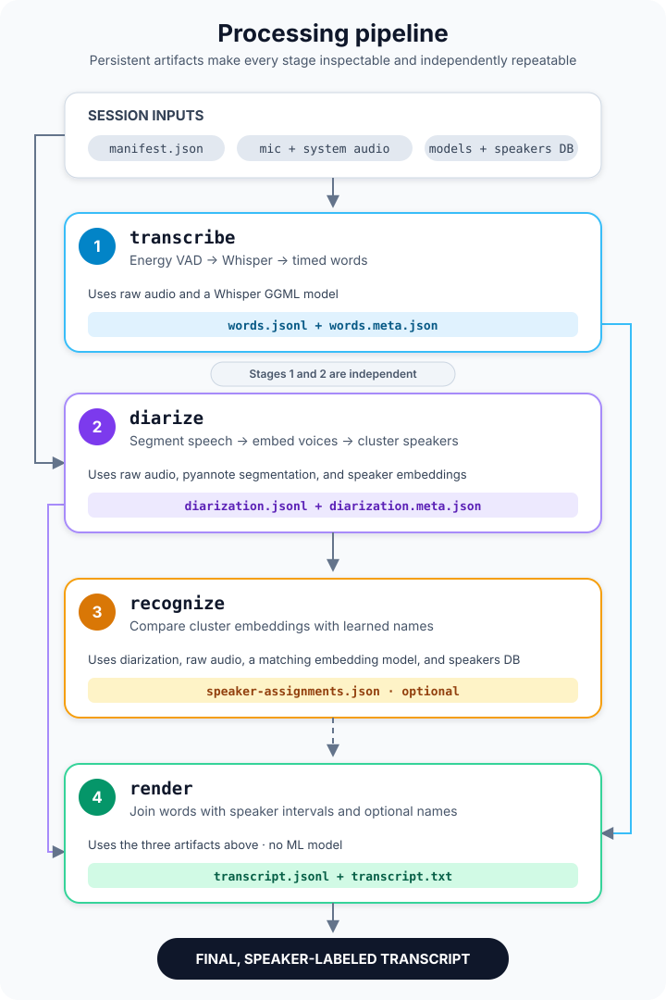

# Processing stages

This guide describes the four persistent processing stages, their models, and
their artifacts. See the [README](../README.md#quick-start) for installation and
a first run.



`transcribe` and `diarize` are independent: neither consumes the other's
output. `recognize` needs diarization, while `render` needs transcription and
diarization and can use recognition when it is available. All timestamps remain
relative to the meeting clock established by `record`.

In the Snap, the first model-backed stage starts the confined model setup
service and waits with a progress bar until the verified per-user cache is
ready. Later stages reuse that cache.

Before a model-backed stage starts, singstone checks the model's file size,
SHA-256 digest and declared purpose against `models.lock`. `--allow-unverified-models`
can explicitly relax that check. Standalone commands generally treat a missing
enabled audio track, model or required upstream artifact as an error, retaining
the existing output. Empty enabled audio and empty diarization are valid empty
inputs; with empty diarization, `recognize` does not open the required model path
or speaker database. The aggregate `process` command keeps its recovery-oriented
behavior: it may skip missing enabled audio and warns on diarization or
recognition failures so a transcript can still be produced. Because it writes
the same artifacts, partial results can replace outputs from earlier tuned stage
runs.

## 1. Transcribe: audio to timed words

```bash
singstone transcribe SESSION \
    --whisper-model ~/.local/share/singstone/models/kb-whisper-small-q5_0.bin \
    --language sv --threads 8
```

**Input:** `manifest.json`, every enabled `audio/*.f32le` track, and a
whisper.cpp GGML model. The audio must be 16 kHz mono float PCM, as produced by
`record`. Every stage also accepts the 16-bit `audio/*.flac` tracks of an
archived session, decoded through the `flac` program.

**Model:** Whisper, through `whisper-rs`. The packaged
`kb-whisper-small-q5_0.bin` is KBLab's Swedish-tuned Whisper Small model in the
official GGML Q5_0 format. It is much smaller than large-v3-turbo and KBLab's
Swedish evaluations report better word error rates than OpenAI large-v3. The
GUI's Swedish transcription toggle is on by default, selecting this model and
the fixed `sv` language. Turning it off selects the packaged multilingual
OpenAI Whisper Small Q5_1 model and automatic language detection. The setting
persists for later meetings. The command line keeps the Swedish default in the
Snap; use both `--whisper-model` and `--language` to choose another combination.
Direct non-Snap builds default to automatic detection. Any compatible,
correctly locked whisper.cpp GGML model can also be supplied. The same loaded
model and inference state are reused for the microphone and system tracks.
Each enabled raw track is read into memory before its transcription pass.

The Snap packages separate CPU and Intel SYCL builds. Its launcher selects the
FP16 SYCL build when a probe can open an Intel GPU, including the Tiger Lake
Iris Xe in the Core i7-1185G7. Intel's oneAPI 2026 GPU support starts with
11th-generation Intel Core integrated graphics; the probe rejects older
devices even when they can run its trivial test kernel, because larger ggml
kernels are not supported there. It prefers Level Zero, retries with OpenCL
when Level Zero fails, and falls back to the CPU build when no supported GPU
runtime works. `SINGSTONE_DISABLE_GPU=1` forces that CPU path. The GUI header
and processing view identify CPU or GPU use, while the Settings page and
transcription log include the device and selected SYCL runtime.

The probe runs with core dumps disabled and records its stages in
`$SNAP_USER_COMMON/gpu-probe.log`. A successful kernel exits directly after
flushing the device name because some Level Zero runtime versions can fail
during process teardown after GPU work has already completed. If probing still
fails, the CPU backend description includes the reason and the log identifies
the last completed discovery stage for both Level Zero and OpenCL attempts.
The launcher points the OpenCL ICD loader directly at the driver bundled inside
the strictly confined Snap rather than using Ubuntu's absolute host path.

The stage performs these operations:

1. It runs an energy-based voice activity detector over 20 ms frames. A frame
   above -45 dBFS is considered speech. The detector keeps 200 ms of hangover,
   rejects raw speech bursts shorter than 250 ms, merges retained regions
   separated by at most 500 ms, and pads them by 300 ms. This detector is signal
   processing and uses no model.
2. Speech regions longer than 25 minutes are split at the quietest 20 ms frame
   within 30 seconds of the target boundary. Regions shorter than one second
   are widened into the surrounding source audio. Only a final inference chunk
   that is still shorter than one second is padded with zero samples, because
   Whisper needs enough samples to process it reliably.
3. Retained audio is passed to Whisper in chunks of at most 30 seconds. The
   decoder uses greedy sampling, token timestamps, no previous-text context and
   the configured thread count.
4. Tokens are grouped at whitespace boundaries, with punctuation attached to
   its word, and timestamps are converted back to meeting-relative
   milliseconds. Empty tokens, bracketed annotations such as `[music]`,
   parenthesized annotations and music-note-only output are removed. Words that
   do not touch a retained VAD region are dropped. Timestamps are clamped to the
   source chunk and made non-overlapping so words do not run backward.
5. Words from both sources are sorted by start time, with microphone words first
   on an exact tie, and written atomically.

The main output is one JSON object per line in `words.jsonl`:

```json
{"source":"system","start_ms":10120,"end_ms":10480,"text":"We"}
```

`words.meta.json` records the format version, output hash, hashes of the audio
tracks that were used, Whisper model hash, language and effective thread count.
`render` checks the recorded hashes and warns if the audio or word file changed
after transcription. Deliberate manual edits remain usable; the warning makes
the provenance mismatch visible.

```json
{
  "format_version": 1,
  "output_file": "words.jsonl",
  "output_sha256": "...",
  "mic_audio_sha256": "...",
  "system_audio_sha256": "...",
  "whisper_model_sha256": "...",
  "language": "en",
  "threads": 8
}
```

Disabled or unavailable input tracks have a `null` audio hash. The metadata
does not include the executable version or the fixed VAD settings, so treat it
as a staleness check rather than a complete recipe for reproducing inference.

## 2. Diarize: audio to anonymous speaker intervals

```bash
singstone diarize SESSION \
    --segmentation-model ~/.local/share/singstone/models/sherpa-onnx-pyannote-segmentation-3-0/model.onnx \
    --embedding-model ~/.local/share/singstone/models/nemo_en_titanet_small.onnx \
    --cluster-threshold 0.5
```

**Input:** `manifest.json`, the optional per-session `meeting.json`, the enabled
audio tracks, and two ONNX models. `process` and `diarize` diarize an enabled
microphone by default. Pass `--diarize-mic=false` to opt out for a legacy or
single-local-speaker workflow.
`words.jsonl` is not an input, so this stage can run before or in parallel with
transcription.

**Models:** a pyannote speaker-segmentation model, run directly through ONNX
Runtime, and a speaker embedding model, run through sherpa-onnx. The
embedding model represents a voice as a numeric vector. Both run on CPU. Each
source is diarized in five steps:

1. The audio is cut into 10-second windows starting every second; the last
   window is padded with silence. For every frame of about 17 ms, the
   segmentation model picks the most likely set of up to two of three local
   speakers in that window.
2. Every local speaker active for at least three frames of a window gets a
   voiceprint: the embedding of the frames where it speaks alone when they
   add up to 0.3 seconds or more, otherwise of all its active frames. When
   that is too short to embed, all its active speech is repeated eight
   times, cut off at ten seconds.
3. The voiceprints with at least two seconds of solo speech, or all of them
   when fewer than two qualify, are clustered by average-linkage
   agglomerative clustering on cosine distance. Merging stops when the
   closest clusters are more than `--cluster-threshold` apart. Beyond 4000
   such voiceprints, 4000 of them, evenly spread in time, are clustered. A
   cluster with fewer than three voiceprints joins the larger cluster with
   the most similar mean voiceprint. When the speaker count is estimated, so
   does one with fewer than 2% of those clustered, so a long meeting does not
   split into fragments of a few seconds each.
4. Every local speaker of a window is assigned a cluster by cosine
   similarity to the clusters' mean voiceprints. A window's local speakers
   get different clusters with the highest summed similarity, so two voices
   the segmentation model told apart within a window are never merged.
   When a window has more local speakers than there are clusters, the ones
   left over are voices the clustering missed, typically someone who only
   gives short replies. Unless the speaker count is fixed, left-over
   voiceprints more than `--cluster-threshold` from every cluster are
   clustered the same way (at most 4000, evenly spread in time); each group
   holding at least 5% of them and either two or more voiceprints or one
   with at least 0.6 seconds of speech becomes a new cluster, and the
   windows are matched again, up to three rounds. A local speaker still left
   over takes its most similar cluster. A window holds at most three local
   speakers, so this finds missed voices only while clustering found one or
   two; a quiet participant in a larger meeting stays merged into the most
   similar voice.
5. The windows are overlaid on one frame grid. Each frame keeps as many
   clusters as the rounded average number of speakers the overlapping
   windows found there, choosing the clusters with the most votes. Runs of
   one cluster less than 500 ms apart become one segment.

Segmentation runs on the configured number of inference threads; embeddings
run on that many worker threads with one inference thread each. ONNX Runtime
is the library that sherpa-onnx already loads, so both share one runtime.

Each source is diarized independently, so microphone cluster `0` and system
cluster `0` describe unrelated voices. `--cluster-threshold` is the average
cosine distance at which merging stops; lower values usually produce more
speakers. The default 0.5 was chosen on synthetic Swedish meetings and
hand-labeled clips of real meetings with the documented TitaNet model.
`--num-speakers N` merges until N clusters remain, before small clusters are
absorbed, separately for each enabled source, and adds no clusters for
left-over voices.
Without that flag, a nonzero remote attendee count in `meeting.json` fixes
the system track's speaker count. It never fixes the microphone count
because remote echo can create extra microphone clusters.
Cluster numbers are local implementation labels, not persistent identities:
cluster `2` from one diarization run need not represent cluster `2` after
changing a model or threshold.

The result is sorted by meeting time and written to `diarization.jsonl`:

```json
{"source":"system","start_ms":12000,"end_ms":18300,"cluster":0}
```

Segment timestamps are converted to integer milliseconds and clamped to the
available audio. `diarization.meta.json` records both model hashes, relevant
settings, effective thread count, input audio hashes and the output hash. It
also records the effective microphone-diarization value: `diarize_mic` is true
only when microphone diarization was requested and the output contains at least
one microphone segment. This lets `render` inherit that policy automatically.
In files written by the earlier sherpa-onnx diarizer, `cluster_threshold` is on
that diarizer's different scale.

```json
{
  "format_version": 1,
  "output_file": "diarization.jsonl",
  "output_sha256": "...",
  "mic_audio_sha256": "...",
  "system_audio_sha256": "...",
  "segmentation_model_sha256": "...",
  "embedding_model_sha256": "...",
  "diarize_mic": true,
  "cluster_threshold": 0.5,
  "num_speakers": null,
  "mic_num_speakers": null,
  "system_num_speakers": 4,
  "threads": 8
}
```

## 3. Recognize: anonymous clusters to learned names

Speaker recognition is optional. Without it, `render` assigns anonymous display
names such as `SPEAKER_00`. These names are deterministic for one fixed set of
diarization segments and assignments, but their numbers can change after either
artifact changes. Use `speaker_id`, such as `spk_3` or `mic_1`, to identify the
underlying source and cluster in a particular diarization result.

```bash
singstone recognize SESSION \
    --embedding-model ~/.local/share/singstone/models/nemo_en_titanet_small.onnx \
    --speakers-db ~/.local/share/singstone/speakers.json \
    --speaker-threshold 0.72
```

**Input:** `diarization.jsonl`, the referenced audio tracks, a sherpa-onnx
speaker embedding model, and the local `speakers.json` database. The database
is built from transcript corrections. Its model SHA-256 digest and embedding
dimension must match the configured model. When present, `meeting.json` also
controls the candidate names considered for each source.

**Model:** any compatible sherpa-onnx speaker embedding model that matches the
speaker database. It will usually be the model used for diarization, and the
documented model is NeMo TitaNet Small, but diarization and recognition do not
require the same model. Recognition does not run the segmentation model and
does not transcribe speech.

Before scoring, the stage writes normalized chunk vectors to
`embeddings.jsonl`. Each diarization segment of length `L` is split into
`ceil(L / 10000 ms)` equal windows. Segments of at least ten seconds therefore
produce windows between five and ten seconds; shorter segments produce one
window. Even a window shorter than 1.5 seconds is retained in the artifact for
completeness, but it is never learned or scored by itself.

```json
{"source":"system","start_ms":12000,"end_ms":18300,"cluster":0,"embedding":[0.01,-0.02]}
```

The vector is abbreviated here; the documented model writes 192 values.

`embeddings.meta.json` records format and output hashes, the diarization hash,
both audio hashes, embedding-model hash, thread count, the 10000 ms window and
the 1500 ms learning minimum. Correction reuses the artifact only when its
recorded output hash matches `embeddings.jsonl` and its diarization, audio and
embedding-model hashes match the current inputs. Otherwise, when a model is
configured, correction regenerates it on demand.

For every distinct `(source, cluster)` pair, recognition then:

1. Uses that cluster's chunks of at least 1.5 seconds as query dots, leaving
   out those that chunks of the source's other clusters cover for 200 ms or
   more in total, since they hold a second voice, unless that leaves none.
   With no usable query dot, the cluster has no candidate.
2. Computes the normalized mean query dot and compares it with the cached
   centroid of every allowed person, retaining the five closest people (or all
   of them when fewer than five are available).
3. For each retained person and each query dot, averages the three highest
   cosine similarities to that person's stored dots, or all dots when the
   person has fewer than three. The person's score is the median of those
   per-query-dot values.
4. Records the highest score as `best_candidate` and assigns that name only
   when the score reaches `--speaker-threshold`. A lower threshold names more
   clusters but raises the chance of a false match. The default is `0.72`.

For system clusters, known remote attendees are the allowed candidates. For
microphone clusters, only known local attendees are allowed. A source remains
unrestricted when its attendee list is empty or its corresponding end has
unnamed people. This is a filtered view of the speaker database; the database
on disk is unchanged.

The version 3 speaker database stores a model identity and, for each name,
its unit-length voice samples ("dots"), the sessions it learned samples in
(in the order they last taught it) and the samples set aside by tidying or by hand. Dot count is
the weight. Each sample records when it was learned (unix seconds), the
session directory name and the track it came from, all absent for samples
imported from older versions, which count as settled. `kept_by_user` marks a
restored sample that tidying leaves alone. Each sample is written on one line.
A normalized mean centroid is computed at load time for candidate
prefiltering but is not written to disk.
Names that differ only by Unicode case or whitespace are merged when the
database is loaded, keeping the spelling from the record with the most dots.
Manual corrections reuse that stored spelling for matching names.

```json
{
  "format_version": 3,
  "embedding_model": {"name":"nemo_en_titanet_small","sha256":"...","dimension":192},
  "speakers": {
    "Alice": {
      "sessions": ["2026-09-14_10-30", "2026-09-21_10-30"],
      "samples": [
        {"embedding":[0.01,-0.02]},
        {"learned_at":1758443400,"session":"2026-09-21_10-30","source":"system","embedding":[0.02,-0.01]}
      ],
      "pruned": [
        {"reason":"sounds_like","rival":"Bob","pruned_at":1758529800,"learned_at":1758443400,"session":"2026-09-21_10-30","source":"system","embedding":[0.3,0.1]}
      ]
    }
  }
}
```

The stored vectors are likewise abbreviated in this example. A removed
sample's `reason` is `sounds_like` (with `rival`), `isolated` or `user`.
Removed samples take no part in recognition or the learned-line mark, and a
tidy pass deletes them 30 days after `pruned_at`.

On first use, a version 2 database is copied to `speakers.json.v2.bak` and
rewritten as version 3. A legacy database without `format_version` is copied
to `speakers.json.v1.bak` (then `.v1.bak.2`, `.3`, and so on if needed), its
vectors are imported under the same names into a version 3 database, and a
line on stderr reports the counts. Each legacy vector was the mean of a whole
diarization cluster, so it counts as one voice sample; a vector from a merged
cluster stays in the database until later corrections outweigh it.
Every change to the database is made under an exclusive lock on
`speakers.json.lock`, so the app, its processing workers and the command line
do not overwrite each other's changes.

The versioned `speaker-assignments.json` contains every diarized cluster, even
when it has no usable embedding or confident match:

```json
{
  "format_version": 1,
  "provenance": {
    "diarization_file": "diarization.jsonl",
    "diarization_sha256": "...",
    "embedding_model_sha256": "...",
    "speakers_database_sha256": "...",
    "meeting_sha256": "...",
    "speaker_threshold": 0.72
  },
  "assignments": [
    {
      "source": "system",
      "cluster": 0,
      "best_candidate": "Alice",
      "score": 0.82,
      "speaker": "Alice"
    }
  ]
}
```

`best_candidate` and `score` remain present below the threshold, while
`speaker` is omitted. This makes threshold problems distinguishable from
embedding failures. Recognition is performed separately for the microphone and
system sources, and the same learned name may legitimately match more than one
cluster.

### Manual assignment and correction

Naming or changing a line creates a lock on that line's exact rendered
`[start_ms, end_ms]` and source. It does not rename the rest of the diarization
cluster and does not edit `speaker-assignments.json`. Locks are stored in the
versioned `speaker-corrections.json` artifact:

```json
{
  "format_version": 1,
  "corrections": [
    {"source":"system","start_ms":41200,"end_ms":47800,"speaker":"Alice"}
  ]
}
```

A newer range replaces older ranges that it overlaps on the same source. At
render time, a word takes the correction's name when its midpoint is inside the
range. The resulting utterance has `"locked":true`; its `speaker_id` remains
the underlying `spk_N` or `mic_N` cluster ID. Locks are never changed by
recognition, proposals, rendering, or reprocessing.

An entry with `"inferred":true` is a name carried forward from a lock to a
later line of the same voice, not a lock:

```json
{"source":"system","start_ms":52950,"end_ms":58560,"speaker":"Alice","inferred":true}
```

Its words take the name but the utterance is not locked, nothing is learned
from it, and it stays a candidate for later proposals. A lock replaces the
inferred entries it overlaps and wins where both cover a word; an inferred
entry replaces only other inferred entries. Like locks, inferred entries are
kept across reprocessing.

Names assigned by hand before this version lived in
`speaker-assignments.json` and are not carried over; reprocessing such a
session loses those names.

When the embedding model is configured, correction also learns every
same-source chunk for which at least half of the chunk overlaps the range,
excluding chunks shorter than 1.5 seconds. If another name previously owned the
lock or is the cluster's current first guess, vectors with cosine similarity at
least `0.999` to a learned vector are removed from that old name. An equivalent
vector already stored under the chosen name is not appended again; one that was
removed is learned again as a new sample. A chunk is skipped when another name
with at least 10 samples scores it at least 0.05 higher than the chosen name
does with its samples from other sessions, of which it needs 10, and at or
above the match threshold; the line keeps its lock, and the printed outcome
counts skipped chunks in `skipped`. After learning, a tidy pass runs as
described under [Tidying](#tidying-learned-voices), and `tidied` counts what it
removed. With a configured model, learning preparation must succeed before the
lock is saved; a rendering failure restores the previous corrections. The
database is updated only after rendering succeeds. Without the model, the line
is still locked and rendered, but learning and unlearning are skipped.
A line outside the meeting marked in `meeting-span.json` (described under
[Render](#4-render-intermediate-artifacts-to-the-final-transcript)) is locked
and renamed, but nothing is learned from it, so talk before or after the
meeting cannot teach a wrong voice. Its vectors are still removed from the old
names, so a voice learned while the line was inside the meeting does not stay
with the wrong person. The model and embeddings are prepared only when an old
name (a replaced lock or the cluster's first guess) holds any samples, set
aside ones included; otherwise such a correction needs neither the model nor the audio and leaves
the database untouched. Later lines are not proposed from a line outside the
meeting.
Microphone corrections are stored and learned in the same way as system-track
corrections.

The app marks a locked line as learned when one of its chunks is stored under
the line's name in the database (cosine similarity at least `0.999`). This is
derived when the session is shown, not recorded: the mark disappears when the
speaker is deleted, when tidying removes the chunk, or when reprocessing moves
the chunk boundaries.

The command-line equivalent is:

```bash
singstone correct SESSION \
    --source system --start-ms 41200 --end-ms 47800 --name Alice \
    --embedding-model ~/.local/share/singstone/models/nemo_en_titanet_small.onnx \
    --speakers-db ~/.local/share/singstone/speakers.json
```

After learning, correction scores later, unlocked utterances from the same
source and cluster. A row is proposed when the new name beats its current name
by at least `0.05`, or, for an unnamed row, when the new score reaches the
speaker threshold. Earlier rows are never proposed. `correct` prints the
outcome and each forward proposal as JSON lines but does not apply proposals.
The GUI applies every proposed row without asking, as an inferred entry. Only
the line named by hand is locked and learned; rows that are not proposed keep
their current name.

### Cutting a line into turns

When diarization heard two or more people as one voice, a line can be cut into
turns, each with its own speaker. The audio is not cut: the line stays one
group with one playback range. Cuts are kept in the versioned
`speaker-turns.json` artifact:

```json
{
  "format_version": 1,
  "groups": [
    {"source":"system","start_ms":38680,"end_ms":45270,
     "turns":[{"start_ms":38680,"speaker":null},
              {"start_ms":43040,"speaker":"Andrew"},
              {"start_ms":44030,"speaker":"Craig"}]}
  ]
}
```

Groups of one source may touch at an endpoint but not overlap, a start is
used once per source, and each group's first turn starts with it and every
turn lies inside it; a file that breaks this is rejected when it is read, and
a cut that would overlap another cut line is refused. A word belongs to a
group when its midpoint is inside `[start_ms, end_ms]` on the same source, and to the last turn that starts at or before the word does,
so a cut sits exactly at the start of the word after it. The first turn starts
with the group. Each turn is rendered as one line of its own, whatever the
voices and pauses inside it, timed from its own words, and never shares a line
with words outside the group; only a change of echo or kept state splits it
further. A named turn takes its name and `"locked":true`, overriding
corrections and recognition. A turn with a `null` speaker keeps what the line
would otherwise get, a correction's name or the cluster's.

Naming a turn names only that turn: no later line is renamed, and no voice is
learned or forgotten, because the audio of a cut line holds more than one
voice. For the same reason a chunk of `embeddings.jsonl` that reaches into a
cut line is never used for a voice: not to learn or unlearn when a
neighbouring line is named, not to score later lines for proposals, and not
for the app's learned-line mark. A cut line is never proposed as a later line
of a voice either. Whenever a line is cut or its cuts change, every sample
that this session learned from the line's source and that matches the vector
of such a chunk (cosine similarity at least `0.999`) is removed, under
whichever name holds it, so audio taught by the line itself or by a
neighbouring line before the cut stops counting; samples learned in other
sessions are left alone. Only the current `embeddings.jsonl` is compared, so a
sample learned before reprocessing moved the chunk boundaries is not found and
stays. Locks stay, so the unnamed turns keep the line's name.

When every turn ends up with the same speaker, counting an unnamed first turn
as the line's current name, the group is removed and the whole range becomes
one locked line, stored as a correction, without learning. Removing every cut
does the same, keeping the first turn's name when it has one. Removing one
cut joins two turns, and the joined turn keeps the earlier turn's speaker. A
line outside the meeting, a hidden line and a kept line move as described
under [Render](#4-render-intermediate-artifacts-to-the-final-transcript).

Like corrections, cuts are keyed by source and time and kept across
reprocessing, and a failed render puts `speaker-turns.json` back as it was.
When new word timings move a word past a cut, the app's cut mode shows the cut
before the first word that rendering puts in its turn, and removing it there
removes it from the file. Words that rendering puts in different turns are
never shown as one, punctuation included. A cut that no longer starts any word
is dropped the next time the cuts are saved; when that empties the first
turn, the first turn takes the speaker of the turn that now holds the line's
first words, so removing every cut shown leaves one line with that speaker.

### Diarization test cases

A line's audio can be labeled by hand and saved as a test case for the
diarization, without changing the transcript or any processing input. Each
case is a private folder (`0700`, files `0600`) in the app's test cases folder,
named `<session folder>_<m>m<ss>s` after the clip start, with `-mic` or `-both`
when the clip is not the line's own track and `-2`, `-3`… when another line's
case has the name:

- `clip.wav`: 16 kHz mono 16-bit PCM of exactly the labeled clip, the line
  with up to 5 s of context on each side within the recording. **Both** sums
  the two tracks and clips to [-1, 1]. Archived sessions are read from FLAC.
- `truth.json`: the labels on the clip's time axis, in seconds rounded to
  10 ms, the shape `score.py`-style scorers read:

```json
{
  "format_version": 1,
  "id": "ami-3min_0m37s",
  "source": {"session": "ami-3min", "session_started": "2026-09-14T10:30:00+02:00",
             "track": "system", "offset_s": 37.68,
             "duration_s": 8.59,
             "line": {"start_s": 38.68, "end_s": 45.27, "speaker": "Laura"}},
  "language": "en",
  "speakers": {"P1": "Speaker 1", "P2": "Speaker 2"},
  "segments": [[1.02, 3.8, "P1"], [2.88, 5.43, "P2"]],
  "exclude": [[6.69, 7.11]],
  "app": {"version": "0.1.0", "segments": [[0.0, 7.6, "Laura"]]},
  "notes": [],
  "labeled_at": "2026-11-04T19:19:46+00:00",
  "editor": {"line": {"source": "system", "start_ms": 38680, "end_ms": 45270},
             "track": "system", "context_ms": 1000, "lanes": 2,
             "bars": [[1, 38697, 41481], [2, 40560, 43110], [0, 44370, 44791]]}
}
```

  `session` and `session_started` (the manifest's start) name the recording
  the case belongs to; a folder name alone does not, since two recordings
  can have folders of the same name.
  `segments` are the speaker bars, `[start, end, "P<lane>"]` sorted by start;
  bars of one lane that touch are joined, and segments that share time are
  overlap. `speakers` lists the labels used, `exclude` holds the *Not sure*
  bars, and `language` comes from `words.meta.json` when it names one.
  `app.segments` is the session's `diarization.jsonl` for the clip's track or
  tracks, cut to the clip; each segment is named like the transcript line of
  its track that it overlaps most, or `spk_N` / `mic_N` by cluster when it
  overlaps none. `editor` keeps the bars in recording milliseconds (`[lane,
  start_ms, end_ms]`, lane 0 for *Not sure*) with the context, track and lane
  count, so the case opens again as it was saved.
- `words.jsonl`: the words whose middle lies in the clip, as
  `{"start", "end", "text"}` on the clip's axis, plus `"source"` for **Both**.
  A word too short to last 10 ms after rounding, such as punctuation, lasts
  10 ms.

`test-cases.json` in the session folder maps each saved line (source, start
and end) to its folder. A line counts as labeled only while its folder is a
real directory whose `truth.json` names this recording and this line; a
folder that is gone, or now holds another case, leaves the line unlabeled. An
unreadable index stops a save with an error rather than being overwritten.

A save never leaves a line without a case it can reach:

1. The case is written to a hidden `.<name>.saving` folder beside its place.
2. It moves in whole. A new name is a plain rename. The line's own earlier
   case of the same name is swapped with it in one step
   (`renameat2(RENAME_EXCHANGE)`); where the file system cannot swap, the
   old case stays and the new one takes the next free name instead.
3. The index is written. If that fails, the swap is undone or the new folder
   removed, so the index still points to the old case. If the swap cannot be
   undone, the old case is kept as `<name>.previous` and the error says so.
4. Only once the index is on disk is the superseded folder removed, as a
   best effort.

Only folders directly in the test cases folder that hold this recording's case
of the line are ever replaced or removed; index entries elsewhere are only
read. A `.<name>.saving` folder left by an interrupted save is removed by the
next save of that same case; other hidden folders are left alone. Processing, rendering and archiving do not read or change the
index. A split never meets it, since only unprocessed recordings can be split.
Deleting a session leaves its test cases where they are.

### Tidying learned voices

A tidy pass runs when the app starts and after every correction that changed
the database. It judges each voice with at least 20 samples using the same
scores the voice map shows. A sample's own score is its top-3 score against
the voice's samples from other sessions, so a batch named after the wrong
person in one meeting cannot vouch for itself. A sample without a session
counts as its own session, and with fewer than ten samples outside the
session, as for a voice learned in one meeting, all of the voice's samples
are used.

- **Sounds like someone else**: another name's top-3 score for the sample is
  at least its own score, at least `0.05` higher, and that name has at least
  10 samples.
- **Isolated**: the sample's own score is below the voice's median own
  score less four robust deviations (1.4826 times the median absolute
  deviation), and at least `0.15` below it. Distance to the voice's center is
  not a reason; a tight group far from it still helps recognition.

A sample with a session is judged only after its voice has learned samples in
three later sessions, counted from the voice's `sessions` list, which keeps its
history when samples are removed. Learning in a session moves it to the end of
that list, so naming lines in an old meeting, or learning a removed sample
again, starts that session's samples settling anew. Imported samples have no
session and are judged at once. A close group that spans two or more sessions
is kept: an isolated sample stays when its close neighbours, those of its five
closest samples from other sessions that are at least as similar as both the
match threshold and the isolation floor, come from another session. That is a
recording condition that recurs, such as a second microphone. A far group from
a single session has no such neighbours and is removed once settled. Restored
samples are never removed. One pass removes at most a tenth of a voice's
samples, the furthest past their limit first, and never takes a voice below 20.
Each pass decides from one reading of the database, so a removal does not make
other samples removable in the same pass, and the removals are then applied
under the lock to the current file, found by their vectors.

```bash
singstone speakers tidy --dry-run --speakers-db ~/.local/share/singstone/speakers.json
```

lists per voice each judged sample, its reason and scores, and whether it
would be removed, is deferred by the per-pass limit, is still settling, or is
kept as recurring or restored. Without `--dry-run` the pass is applied.

## 4. Render: intermediate artifacts to the final transcript

```bash
singstone render SESSION
```

**Input:** `manifest.json`, `words.jsonl`, `diarization.jsonl`, their metadata
sidecars when present, optionally
`speaker-assignments.json`, optionally `speaker-corrections.json`, optionally
`speaker-turns.json`, optionally
`hidden-sources.json`, optionally `meeting-span.json`, optionally
`embeddings.jsonl` when its metadata matches the current `diarization.jsonl`,
and the audio tracks when both are available. Missing assignment, correction, hidden-source, and
meeting-span data is allowed, but malformed or unsupported assignment,
correction, hidden-source, meeting-span, or diarization metadata is an error. This stage uses no ML model and is fast.

When both audio tracks are available, `render` builds 10 ms RMS envelopes and
examines every non-overlapping two-second system-audio window with enough
activity. Correlated windows become delay-and-gain reference points only when
at least two nearby candidates agree on the delay. Nearby means within 180
seconds, so reference points can exist in one part of a meeting without a bad
or changed section vetoing the whole session.

For each microphone word, `render` separately estimates delay and gain from up
to three nearest reference points before the word and up to three after it,
within the same 180-second horizon. Passing the audio test with either estimate
marks the word as echo, which lets volume, microphone gain, delay, or headphone
changes take effect from whichever side already reflects the new path. A word
whose microphone energy clearly exceeds the predicted leak stays unmarked as
local speech or double talk. A comparison of timed word sequences then runs
over words not marked by the audio pass and can mark a text match confirmed by
correlated audio. If an audio track cannot be read, only the stricter
long-sequence text fallback is available. No words are deleted, and the raw
`words.jsonl` remains unchanged.

From the same envelopes, `render` decides for every 10 ms which track carries
the speech, its *lead*: the microphone where it is at least three times its
noise floor and 8 dB louder than the echo predicted from the system audio, the
system audio where it is active and the microphone is not, or both when both
hold. The noise floor is the 10th percentile of microphone levels above
-70 dBFS, and never lower, so stretches of digital silence do not count. The
predicted echo is the system envelope, delayed, held over a room tail that
decays by 30% per frame for 150 ms, and scaled by the leak gain: the 20th
percentile of the microphone-to-prediction ratio over the system's active
frames within 60 seconds. Local speech only raises that ratio, so its low end
is the leak, and following it in time copes with volume changes. The delay
comes from the nearest reference point within 180 seconds. Without any, one
delay between -50 and 300 ms is estimated for the whole recording from the
correlation of the log envelopes over the system's active frames, leaving
out frames where the microphone is more than about 13 dB above the median
ratio (someone in the room talking over the remote side); the earliest delay
within 0.02 of the best correlation wins, since speech rhythm repeats the
true peak a syllable later. The microphone hears the loudspeaker (an *echo
path*) when there are reference points or that correlation reaches 0.3;
without one, as with headphones, the leak gain is zero.

Each utterance records the most common lead over its time as `"lead"`
(`"mic"`, `"system"`, or `"both"` when double talk is at least as common as
either); it is omitted when only one track was recorded. A system utterance
is looked up one loudspeaker delay later, where its sound reaches the
microphone.

Before any echo pass, `render` finds where someone in the room talks, and
no pass marks those words as echo:

- every stretch of at least 400 ms of frames the microphone leads, alone or
  over the system audio, with gaps of at most 100 ms, widened by 250 ms on
  both sides, since people cut in and trail off under the other side;
- every diarized microphone turn of a *room voice* in which the microphone
  leads at least five frames, from the turn's start to its end. A microphone
  cluster is a room voice when the microphone leads at least 40% of the led
  frames of its turns and, when `embeddings.jsonl` holds voiceprints, its
  voiceprint has a cosine similarity below 0.5 to every system cluster's.

A microphone cluster at or above that similarity is an *echo voice*: the
loudspeaker's echo still sounds like the remote speaker it repeats.

With an echo path, a final pass marks microphone words that the audio and
text passes left when the system audio alone leads at least 70% of the
word's led frames, or 40% inside an echo voice's turns, where the room's
reverberation after the remote speaker stops can make the microphone lead: in a call one side usually talks at a time, so microphone
sound that is not clearly louder than the predicted echo of a talking remote
side is that echo, even where distortion or room sound keeps the envelopes
from correlating. A word with fewer than five led frames of its own is judged
on a 200 ms stretch around it, and only when none of its own frames has the
microphone leading. These detections carry `"evidence":"lead"`, the delay in
`audio_delay_ms` and no similarity.

Every detected run is written to `echo-detections.jsonl`, including the two
spans, `words` count, evidence kind, and optional text similarity, audio
similarity, and estimated delay. Audio-first detections omit text similarity;
lead detections omit both similarities.
An empty file means no microphone words were detected as echo. Rendering also
removes the obsolete `leakage-suppressions.jsonl` artifact when present.

For each word, `render` considers only diarization segments from the same audio
source. It chooses the cluster with the greatest timestamp overlap. When there
is no overlap, it can use the nearest segment within 500 ms; otherwise the word
is assigned to `unknown`.

Because microphone diarization is the processing default, microphone words
normally use microphone cluster IDs and recognized or anonymous names instead
of the local name in `manifest.json`. `render` reads the effective value from
`diarization.meta.json`: it is true only when microphone diarization was
requested and at least one microphone segment was produced. When it is false,
microphone words use the manifest's local name with speaker ID `local`; when it
is true, a word with no overlapping or nearby microphone segment becomes
`unknown`. For legacy sessions without metadata, `render` infers the choice
from the presence of microphone segments.
`--diarize-mic` and `--diarize-mic=false` provide explicit overrides; an
override that conflicts with current metadata is rejected instead of silently
changing speaker attribution.

Unrecognized clusters receive `SPEAKER_NN` display names in first-seen segment
order. `NN` is a display counter rather than the cluster number. Recognized
names replace only the display name; the source and numeric cluster remain
visible through IDs such as `spk_3` or `mic_1`.

Corrections are then overlaid per word using the midpoint rule described above.
They override recognized and anonymous display names without replacing the
cluster ID. Grouping starts a new utterance when the lock state changes, so a
confirmed range cannot be merged into an unlocked row.

The turns in `speaker-turns.json` are applied next, as described under
[Cutting a line into turns](#cutting-a-line-into-turns).

Audio-detected words form their own microphone utterances and carry
`"echo":true` in `transcript.jsonl`. Surrounding local words form separate,
unmarked utterances, and system utterances are never marked. Older transcripts
that stored a string in `echo` still open: any old string value is read as
`true`. The text transcript adds `[echo]` after the speaker name.

Adjacent words are grouped into utterances. A new utterance starts when the
speaker ID, display name, lock state, or echo flag changes, the silence between
words exceeds one second, or an utterance has reached 15 seconds and ends with
sentence punctuation. Whitespace and punctuation spacing are normalized, and
utterances from both sources are sorted on the common meeting timeline.

`hidden-sources.json` can leave one or both sources out of the final
transcript, except for the lines it keeps:

```json
{
  "format_version": 2,
  "hidden": ["mic"],
  "keep_local_speaker": true,
  "keep_speakers": ["Anna"],
  "keep": [{"source": "mic", "start_ms": 1834200, "end_ms": 1839900}]
}
```

Utterances of a hidden source are omitted from `transcript.jsonl` and
`transcript.txt` unless a keep rule applies:

- `keep_local_speaker` keeps lines named after `local_speaker` in
  `manifest.json`, the app's **Your name in the transcript**, whose voice was
  told apart: lines of a diarized cluster that recognition named so, and lines
  you named so yourself. It does not match the
  `local` speaker ID that every microphone line gets when microphone
  diarization is off, so that hiding the microphone still hides it. It defaults
  to true, so hiding the microphone keeps your own lines. It is a flag rather
  than a copy of the name, so it follows the manifest.
- `keep_speakers` keeps every line of the listed names, on either source,
  anonymous `SPEAKER_NN` names included, by name alone. The app's **Keep all
  of X's lines** adds X here, your own name too, so it keeps your lines even
  with microphone diarization off; the ✕ on a name's chip removes the name and,
  for your own name, turns `keep_local_speaker` off as well.
- Names match ignoring case and repeated whitespace. A line marked echo is never
  kept by a speaker rule, because it is leaked loudspeaker sound whatever name
  diarization gave it.
- `keep` keeps stretches of a source the way corrections name them: a word is
  kept when its midpoint lies in `[start_ms, end_ms]`, and grouping starts a
  new utterance when that changes, so a kept range survives regrouping and
  reprocessing. A kept range keeps echo too.

A speaker rule follows the rendered name, so naming a hidden line yourself
(see [Manual assignment and correction](#manual-assignment-and-correction))
lets your rule keep it, and the later lines of that voice you accept. Hidden
lines can be named, and later hidden lines are proposed like transcript lines.
The turns of a cut line are lines of their own here, so a speaker rule keeps
only the turns of that speaker; the app offers each turn its own speaker's
rules, and **Keep this line** on any turn keeps the whole cut line.

Every utterance of a hidden source that nothing keeps is written to
`hidden-lines.jsonl`, in the transcript's format and whether it is inside the
meeting or not, so the app can still show it; that file exists only while a
source is hidden. Rules for a source that is not hidden have no effect but
stay on file, so hiding it again keeps the same lines. The file is removed when
it hides nothing and holds only defaults. Version 1 files, which have only
`hidden`, still open and keep nothing, so their transcripts stay as they were.
A session rendered before `hidden-lines.jsonl` existed has none; the app
renders it when you ask to show the hidden lines, writing the same selection in
version 2.
Use the app to toggle a source and keep lines, or edit the file and run
`singstone render SESSION`. Remove a source from `hidden`, or remove the file,
and render again to bring its lines back.

`meeting-span.json` marks where the meeting starts and ends when the recording
runs longer than the meeting:

```json
{
  "format_version": 1,
  "start_ms": 72000,
  "end_ms": 2790000
}
```

Either bound may be left out, and the meeting then reaches that edge of the
recording. The meeting must not be empty: `end_ms` must be above `start_ms`,
or above 0 without a start, and when the recorded audio can be read, `start_ms`
must be below its length. An
utterance belongs to the meeting when its `start_ms` lies in
`[start_ms, end_ms)`; the turns of a cut line all go where the group's first
turn starts, whichever of them are shown. Utterances outside it are omitted from
`transcript.jsonl` and `transcript.txt` and written instead to
`outside-meeting.jsonl`, in the same format, so the app can still show them;
that file exists only while the session has a span. Timestamps stay relative to
the start of the recording. The span wins over keep rules: a kept line outside
the meeting goes to `outside-meeting.jsonl`, and lines of hidden sources that
nothing keeps go to `hidden-lines.jsonl` instead, so each line is in exactly
one of the three files. The
span changes no other artifact: the audio, `screenshots.jsonl`, which is
written while recording, and the transcription, diarization and recognition
stages do not look at it. In the app, right-click a line or its time and choose
**Meeting starts here** or **Meeting ends here**. A start mark is the start of
that timeline row. An end mark is the latest end of the row's lines, cut back
to the start of the next row when that row starts earlier, so the meeting ends
right after the chosen row even when the next line overlaps it. Remove a bound
from the file, or the whole file, and render again to widen the meeting; the
app's ✕ on a mark and **Use the whole recording** do the same. When rendering
after a change in the app fails, `meeting-span.json`, `outside-meeting.jsonl`,
`hidden-lines.jsonl`, `transcript.jsonl` and `transcript.txt` are all put back
as they were, so they keep agreeing; the same holds for changes to hidden
sources, kept lines and corrections.

The stage replaces the canonical `transcript.jsonl` and readable
`transcript.txt` atomically one file at a time:

```json
{"start_ms":12340,"end_ms":15780,"source":"system","speaker_id":"spk_0","speaker":"Alice","text":"I think we should ship it on Friday.","locked":true}
```

Unlocked utterances omit the `locked` field. The turns cut from one line share
a `group` id, such as `"group":"system-38680"`, which other lines omit.

```text
[00:00:12.340] Alice: I think we should ship it on Friday.
```

Before rendering, singstone compares the available provenance hashes with the
current intermediate files and audio. Edited or replaced word and diarization
artifacts produce warnings but remain renderable. Speaker assignments are
treated more strictly: if their recorded diarization path or hash does not
match, all first-guess names are discarded and clusters remain anonymous unless
a correction covers them. Corrections are keyed by source and time range, not
cluster, so they remain active when diarization settings or cluster numbers
change. This staleness check does not compare the current speaker database,
embedding model or recognition threshold; rerun `recognize` yourself after
changing any of those inputs.

## Rerun recipes

| Problem or goal | Commands to rerun |
|---|---|
| Incorrect words or language | `transcribe`, then `render` |
| Too many or too few speaker clusters | `diarize`, `recognize`, then `render` |
| Change one line's speaker | Use the app, or `correct` with that row's exact source and time range |
| Refresh automatic first-guess names | `recognize`, then `render` |
| Manually edited words | `render` |
| Manually edited speaker segments | `recognize`, then `render`; or only `render` for anonymous names |
| Leave out the microphone or system-audio lines | Use the app, or edit `hidden-sources.json`, then `render` |
| Keep some lines of a hidden source | Use the app, or edit `keep_speakers` or `keep` in `hidden-sources.json`, then `render` |
| Leave out talk before or after the meeting | Use the app, or edit `meeting-span.json`, then `render` |
| Anonymous transcript with no speaker database | Skip `recognize`; run `render` |
| Multiple people are listed in the room | Save meeting details, then `diarize`, `recognize`, and `render` |
| Changed who was in the meeting | `recognize`, then `render` when candidate names changed; otherwise `render` |

Changing attendee names also changes the recognition candidate set, so rerun
`recognize` before `render` when those names should be matched automatically.
Every rerun recipe preserves `speaker-corrections.json`,
`hidden-sources.json` and `meeting-span.json`; `process` and the individual
`transcribe`, `diarize`, `recognize`, `render`, `correct`, and `archive` stages
never edit or delete these files.
A finished `process` run does remove the session's `done` marker, the empty
file behind the app's **Done** label, because the new transcript has not been
reviewed.
The app's **Process again** flow therefore keeps confirmed lines. To discard
every confirmed line, remove `speaker-corrections.json` manually.

The VAD thresholds and chunk sizes described above are currently fixed. Whisper
chunks do not overlap and do not share text context, so transcription quality
can degrade at a 30-second boundary. Stop `record` before processing its session.
`transcribe` and `diarize` may run concurrently because they write disjoint
artifacts. Concurrent runs of the same stage, or a downstream stage while its
upstream artifact is still being written, are unsupported.
