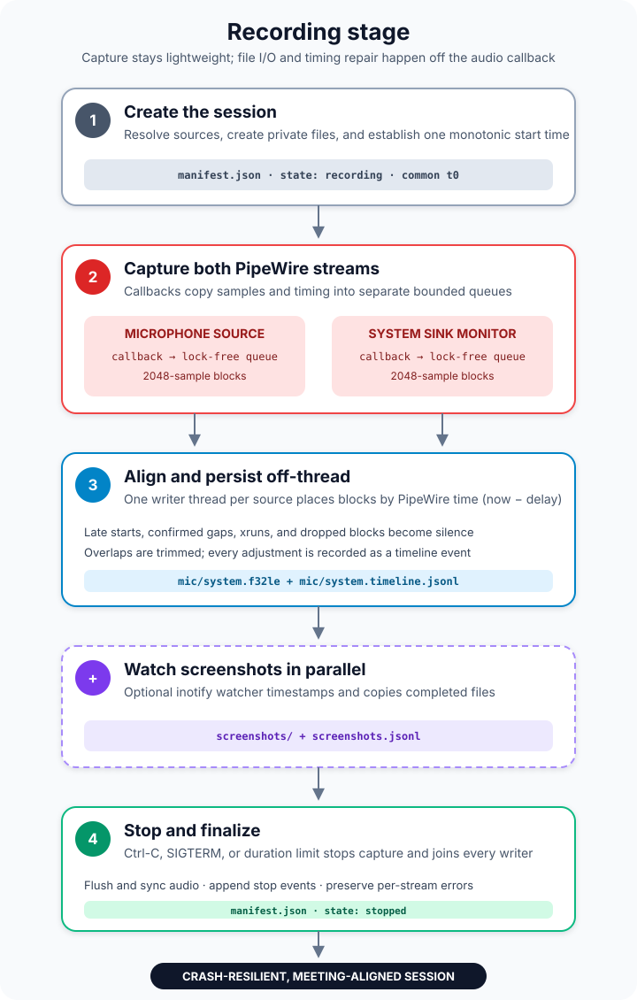

# Recording

`singstone record` captures microphone audio, system audio, or both into a new
session directory. It performs no model inference and needs no network access.
See the [README](../README.md#quick-start) for installation and a first run.

```bash
singstone record --mic default --system default \
    --screenshots ~/Pictures/Screenshots \
    --local-speaker "Me"
```



## Inputs and outputs

Device arguments accept `default`, `none`, a PipeWire node ID, or a node name
shown by `singstone devices`. System audio comes from the selected sink's
monitor. At least one audio source must be enabled.

The command creates a private `session-YYYYMMDD-HHMMSS/` directory containing:

| Artifact | Contents |
|---|---|
| `manifest.json` | State, start time, audio format, source selection, and local speaker |
| `audio/mic.f32le` | Meeting-aligned 16 kHz mono float PCM from the microphone |
| `audio/system.f32le` | Meeting-aligned 16 kHz mono float PCM from the sink monitor |
| `audio/*.timeline.jsonl` | Start, xrun, dropped-block, overlap, clock-jump, error, and stop events |
| `screenshots/` | Copies of screenshots created while recording |
| `screenshots.jsonl` | Meeting timestamp, copied path, and original path for each screenshot |

Disabled sources do not produce audio or timeline files.

`singstone archive` later replaces each `audio/*.f32le` file of a processed
session with a verified 16-bit `audio/*.flac` copy. The manifest keeps
describing the capture format; readers use whichever file exists and prefer
the raw one.

`singstone split SESSION --at TIME` cuts a session that has not been processed
into two new sessions next to it, named after their start times. The tracks
are cut at the same sample; screenshots and timeline events go to the part
they fall in, with their times rebased to it (a screenshot entry whose file is
missing, a symlink, or outside `screenshots/` is left out), and a track that ends before the
second part starts is left out of that part and marked disabled in its
manifest. Each part gets a `split-from.json` naming the original folder, its
title, the cut in milliseconds, and the part number. Only after both parts are
written in a staging folder, moved into place, and their sample counts checked
against the original is the original archived; its `split-into.json` lists
every split made from it. Any failure removes the parts and leaves the
original as it was.

`singstone merge SESSION SESSION...` joins sessions that have not been
processed, are not archived and do not overlap in time into one new session
next to them, by default in start-time order (`--keep-order` keeps the order
given). The tracks are the pieces one after another with one second of
digital silence between them; a piece that lacks a track or whose track is
shorter than the piece gets silence there, so all tracks stay aligned.
Timeline events and screenshots are shifted by the piece's offset. The new
folder is named after the first piece's start. Its `merged-from.json` lists
the pieces in order (folder, title, start, offset and length in
milliseconds, and whether the order was the recorded one), and each piece's
`merged-into.json` lists the merges it went into. The merge is written to a
staging folder and every track is read back and compared byte for byte with
the pieces, the silence included, before it is moved into place; then all
pieces are archived together or not at all. Any failure removes the new
session and restores the pieces' records.

A session joined from recordings made at different times has a
`wallclock.json`: `segments` of `offset_ms`, `length_ms` and
`started_wallclock`, one per stretch recorded in one go. The time of day at
an offset is the start of its stretch plus the time into it; the seam
silence after a stretch maps to its end. Without the file, the recording is
one stretch from `started_wallclock`. Splitting such a session gives each
part the stretches it covers, and a part's start time comes from them.

## Audio capture

Both streams share one monotonic start time. Each PipeWire callback validates
the negotiated 16 kHz mono `f32le` format, copies samples and PipeWire timing
into 2,048-sample blocks, and pushes them into its bounded lock-free queue. It
does no filesystem I/O.

A writer thread per source places blocks using PipeWire's stream time
(`now - delay`). Late starts and confirmed gaps are filled with silence so the
files remain aligned to the meeting clock. Blocks whose timestamps overlap
continue at the current output position, and substantial overlaps are logged.
Queue overruns, xruns, clock jumps, and stream errors are also appended to the
source timeline instead of being hidden. Gap insertion is capped at 60 seconds
per block; larger requested gaps are recorded as `clock_jump` events.

Audio is flushed at least once per second. On shutdown, writers append a stop
event, flush and sync their files, and record any stream error in the manifest.
One failed source does not stop another healthy source. The command fails if all
enabled sources fail or capture no samples.

## Screenshot watcher

With `--screenshots DIR`, an inotify thread watches for completed writes and
files moved into `DIR`. Matching extensions are copied into the session using a
meeting-time prefix, synced, and appended to `screenshots.jsonl`. Existing files
are ignored. Watcher errors are warnings and do not interrupt audio capture.

## Stopping

Stop with Ctrl-C, SIGTERM, or `--duration SECONDS`. Singstone joins the watcher
and writers, preserves per-stream errors, and atomically changes the manifest
state from `recording` to `stopped`.

An interrupted session keeps its append-only capture files. Processing can read
recovered audio while the manifest still says `recording`, but finish recording
before starting any processing stage to avoid races with growing files.

## Remote control

On the `io.github.nsg.Singstone` session bus name, `/io/github/nsg/Singstone/Recorder` implements `io.github.nsg.Singstone.Recorder`.

| Methods | Signal | Status keys |
|---|---|---|
| `StartRecording`, `StopRecording`, `GetStatus` | `StatusChanged` | `recording`, `stopping`, `mic`, `system`, `mic_level`, `system_level`, `elapsed`, `screenshots` |
